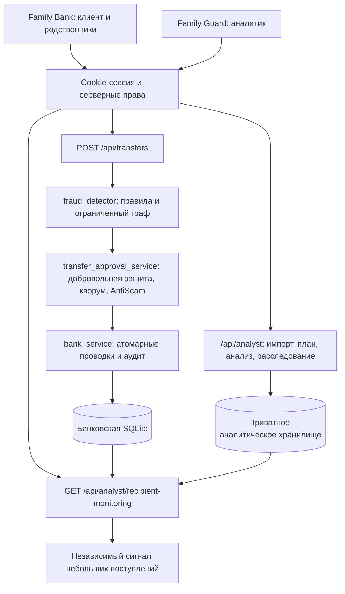

# Архитектура Family Bank и Family Guard

Актуальное реализованное состояние на 15 октября 2026. Один FastAPI-сервис обслуживает клиентский Family Bank на `/` и кабинет Family Guard на `/analyst/`. Соседние исходные проекты не используются во время запуска. Совместимые технические имена — [branding.md](branding.md).

## Потоки данных

## Реальная структура

| Путь | Ответственность |
| --- | --- |
| `backend/app/main.py` | Lifespan, регистрация API, same-origin guard, раздача двух интерфейсов |
| `backend/app/api/auth_routes.py`, `bank_routes.py`, `family_routes.py` | Аккаунты, карты, история, приглашения и настройки |
| `backend/app/api/transfer_routes.py`, `risk_routes.py` | Денежная команда, очереди/решения и отдельный preview |
| `backend/app/api/bank_event_routes.py`, `recipient_monitoring_routes.py`, `analyst_auth_routes.py` | Банковские события, мониторинг и роль сотрудника |
| `backend/app/core/database.py`, `security.py`, `analyst_security.py`, `deployment.py`, `analyst_assets.py` | Сессии БД, роли, настройка деплоя и SPA-маршруты |
| `backend/app/domain/models.py`, `schemas.py`, `approval_schemas.py`, `risk_schemas.py`, `protection_schemas.py` | SQLAlchemy-модели и публичные схемы |
| `backend/app/services/transfer_approval_service.py`, `bank_service.py` | Политика согласования и атомарное исполнение |
| `backend/app/services/family_service.py`, `mock_egov.py`, `protection_changes.py` | Согласие, родство и ожидание перед ослаблением защиты |
| `backend/app/services/fraud_detector.py`, `transaction_rules.py`, `risk_explanations.py` | Онлайн-риск и безопасные объяснения |
| `backend/app/services/recipient_monitoring.py` | Независимый детектор концентрации небольших поступлений |
| `backend/app/risk_ledger/` | Аналитические API, адаптеры, mapper, планировщик, runtime и сохранение результатов |
| `backend/app/migrations.py`, `seed.py` | Сохранные миграции и демонстрационные аккаунты |
| `frontend/aman/`, `frontend/analyst/` | Family Bank HTML/CSS/JS и Family Guard React/TypeScript |
| `backend/tests/`, `frontend/analyst/tests/` | Регрессионные и независимые security-проверки |

## Перевод и семейная политика

`POST /api/transfers/risk-check` возвращает предварительный риск, `family_protection_active` и `requires_risk_acknowledgement`, не исполняя перевод. `POST /api/transfers` повторно вычисляет решение на сервере; preview не предоставляет разрешение на списание.

Команда принимает обязательный `Idempotency-Key`, изолированный по пользователю. Под SQLite `BEGIN IMMEDIATE` обновляются ранее загруженные сущности, проверяются карта, сумма, баланс, настройки защиты и участники. При выключённой защите high/critical требует строгого `risk_warning_acknowledged=true`; без подтверждения HTTP 428 и отсутствие списания. После подтверждения перевод допускается, если отдельный AntiScam не требует `bank_review`.

При включённой защите высокий риск создаёт `TransferRequest` со статусом `pending_approval` и фиксированным составом до трёх `TransferParticipant`. До всех ответов денег не списывают. Единогласное approve разрешает исполнение с учётом AntiScam, reject отклоняет, смешанные ответы дают `bank_review`. Сотрудник не обходит незавершённый семейный кворум. Включённая защита без действующего согласия даёт `blocked_no_trusted`. Сумма и получатель неизменны; для других реквизитов создаётся новая заявка. Истечение — 24 часа, деньги не резервируются.

| API | Полномочия |
| --- | --- |
| `GET /api/transfers/requests` | Собственные запросы отправителя |
| `GET /api/transfers/pending-requests` | Запросы назначенного родственника |
| `POST /api/transfers/requests/{request_id}/approve` или `/reject` | Проверенный участник конкретного запроса |
| `POST /api/transfers/requests/{request_id}/cancel` | Отправитель в допустимом состоянии |
| `GET /api/analyst/bank-events` и `/{request_id}` | Сотрудник с ролью analyst, без загрузки файла |
| `POST /api/analyst/bank-events/{request_id}/approve` или `/reject` | Сотрудник, только bank_review, обязательное основание |

`bank_service.post_transfer` не делает отдельный commit: условное списание при достаточном балансе, зачисление, обе проводки, итог запроса и аудит фиксируются одной транзакцией. Деньги хранятся целыми тиынами. `risk_json` и `policy_json` сохраняют момент оценки и подтверждение предупреждения. `anti_scam_json` хранит nullable boolean ответы отдельно от численного риска. `BankReviewDecision` фиксирует автора и основание с уникальностью на запрос.

## Семейные связи

`TrustedInvitation` хранит адресное назначение, проверку родства и согласие. До трёх pending/accepted приглашений могут сосуществовать. `TrustedPerson` содержит глобальные настройки и совместимую сводку первой принятой связи. Приглашения обслуживаются `/api/trusted-invitations`, Mock eGov — `/api/mock-egov/verify-relationship`.

`ProtectionChangeRequest` создаётся через `POST /api/protection-change-requests`: отключение либо адресное удаление с `invitation_id`. Ожидание — 24 часа с отменой. До срока семейные полномочия действуют; после срока отключение сохраняет принятое приглашение, удаление отзывает адресную связь. Отзыв участника не сокращает кворум старого запроса. Сроки применяются при обращениях к API, фонового обработчика нет. Контракты — ADR-012/013/016.

## Аналитика и мониторинг

Роль `analyst` проверяется сервером через общую сессию. Собственные файловые анализы имеют владельца, чужие ID не предоставляют доступ. API `/api/analyst/analyses` принимает структурированные файлы; SQLite открывается для чтения, SQL разбирается без исполнения. План, запуск, расследование, объяснения и экспорт не меняют банковские деньги. Результаты находятся в приватном runtime, модельные артефакты — в отдельном приватном registry. Профиль транзакций работает на правилах без ML; клиентский CatBoost-профиль явно недоступен без доверенной модели.

`GET /api/analyst/recipient-monitoring` читает до 50 000 завершённых банковских дебетов с проверенными кредитовыми парами либо до 100 000 результатов собственного завершённого анализа. Независимый движок ищет сильнейшее историческое 60-минутное окно: ≥10 небольших переводов ≤10 000 KZT, ≥8 новых отправителей, доля новых ≥80%. Новизна определяется доступной предшествующей историей. Runner сохраняет исходную сумму и валюту без изменения оценок. Страница показывает причины, отправителей и до 200 операций, раскрывает усечение и ограничения. Это чтение, без изменения банковского скоринга, проводок или таблиц. Контракт — [recipient-monitoring.md](recipient-monitoring.md), ADR-017.

## Деплой и хранение

Dockerfile собирает React на Node 24 и копирует dist в Python 3.13 runtime. Один Uvicorn worker обслуживает оба интерфейса; только разрешённые глубокие ссылки аналитика получают SPA fallback. `/api/readiness` проверяет хранилище и сборку UI. Закрытые БД, файлы и исходники не раздаются браузеру. Same-origin guard защищает изменяющие запросы, API возвращает `Cache-Control: no-store`.

Compose по умолчанию слушает `127.0.0.1`; внешний HTTPS требует reverse proxy. Непривилегированный процесс, read-only root filesystem и постоянный том `/data`. Multipart spool находится в `/data/upload-tmp`, `/tmp` остаётся tmpfs 256 МиБ. На диске могут одновременно существовать spool и staged copy; планируйте около 2×размера файла плюс результаты и БД. Миграции создают backup и сохраняют строки/индексы; проверяется целостность внешних ключей.

SQLite и задания в одном процессе ограничивают масштабирование. Реальные платёжные сети, eGov, внешние уведомления, валидированная ML-модель и промышленный пилот не подключены. Запуск, backup и восстановление — [DEPLOYMENT.md](../DEPLOYMENT.md).
